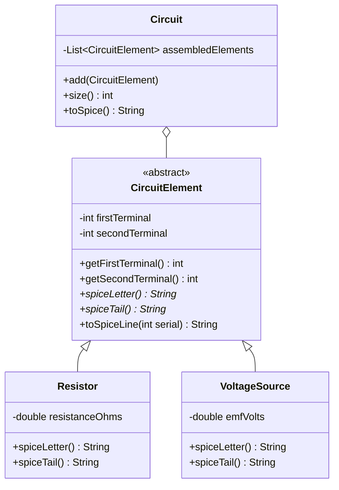

<div align="center">

# Circuit Builder: Java to SPICE

### Describe a circuit in simple text commands and get a simulation-ready SPICE file, built in object-oriented Java


</div>

---

## Overview

SPICE is the standard tool engineers use to simulate electronic circuits, and it reads circuits as a plain-text **netlist**: one line per component, listing its type, the nodes it connects and its value.

This project lets you describe a circuit one component at a time, then generates the matching SPICE netlist automatically. Each component gets a numbered name (`R1`, `R2`, `V1` and so on) with no manual bookkeeping.

The more interesting part is the design. Every component shares one abstract base class, so adding a new part type (a capacitor, say) means writing a single small subclass and changing nothing else.

---

## How It Works


When you ask for the netlist, `Circuit` walks through its elements in order and keeps a running count for each component letter in a `HashMap`. That's how resistors and voltage sources each get their own sequence (`R1, R2, R3` and `V1, V2`), even when they're mixed together.

---

## Class Design



| Class | Role |
|:--|:--|
| **`CircuitElement`** | Abstract base class. Stores the two terminal nodes and builds a full SPICE line from the pieces each subclass supplies. |
| **`Resistor`** | Supplies the letter `R` and its resistance in ohms. |
| **`VoltageSource`** | Supplies the letter `V` and its value as `DC <volts>`. |
| **`Circuit`** | Holds the list of elements, numbers them per type and assembles the final netlist. |
| **`UserMain`** | A command-line front end that reads commands line by line and builds the circuit. |

> **Template method pattern:** `toSpiceLine()` is written once in the base class. Subclasses only fill in `spiceLetter()` and `spiceTail()`, which keeps the formatting logic in one place.

---

## Usage

Run `UserMain` and type commands, one per line:

| Command | Meaning |
|:--|:--|
| `r <node1> <node2> <ohms>` | Add a resistor between two nodes |
| `v <+node> <−node> <volts>` | Add a DC voltage source |
| `spice` | Print the current netlist |
| `end` | Exit the program |

Blank lines and unknown commands are skipped, so a typo doesn't crash the program.

### Example Session

**Input**

```text
v 1 0 2
r 1 2 0.25
v 2 0 3
r 2 3 0.5
r 3 0 1
spice
end
```

**Output**

```text
V1 1 0 DC 2.0
R1 1 2 0.25
V2 2 0 DC 3.0
R2 2 3 0.5
R3 3 0 1.0
All Done
```

---

## Testing

A **JUnit 4** suite (`CircuitTest.java`) checks the core behaviour:

| Test | What it checks |
|:--|:--|
| **`sizeCountsEveryElementAdded`** | The circuit counts every element added to it. |
| **`toSpiceMatchesHandoutExample`** | The generated netlist matches the reference example exactly, line for line. |
| **`toSpiceOnEmptyCircuitIsEmpty`** | An empty circuit produces an empty netlist. |

---

## Project Layout

| Path | Contents |
|:--|:--|
| `src/coe318/lab7/CircuitElement.java` | Abstract base class for all components |
| `src/coe318/lab7/Resistor.java` | Resistor component |
| `src/coe318/lab7/VoltageSource.java` | DC voltage source component |
| `src/coe318/lab7/Circuit.java` | Circuit container and netlist builder |
| `src/coe318/lab7/UserMain.java` | Command-line interface |
| `test/coe318/lab7/CircuitTest.java` | JUnit test suite |
| `build.xml`, `nbproject/` | NetBeans / Ant project files |

---

## Running It Yourself

**In NetBeans:** open the project folder, then use **Run Project** to start `UserMain`, or **Test Project** to run the JUnit tests.

**From the command line:**

```bash
javac -d out src/coe318/lab7/*.java
java -cp out coe318.lab7.UserMain
```

---

## Skills Demonstrated

- **Object-oriented design:** abstract classes, inheritance and polymorphism
- **Design patterns:** template method, with shared formatting in the base class
- **Encapsulation:** immutable `final` fields with getters only
- **Java Collections:** `ArrayList` for ordered storage, `HashMap` for numbering each component type
- **Input parsing:** a small, typo-tolerant command interpreter using `Scanner`
- **Unit testing:** JUnit 4 tests checked against a known reference output
- **Domain knowledge:** SPICE netlist format and circuit node notation

---

## Tools

| | |
|:--|:--|
| **Language** | Java 11 |
| **Testing** | JUnit 4.13.2 |
| **IDE / Build** | Apache NetBeans (Ant) |

<br/>

<div align="center">

</div>
